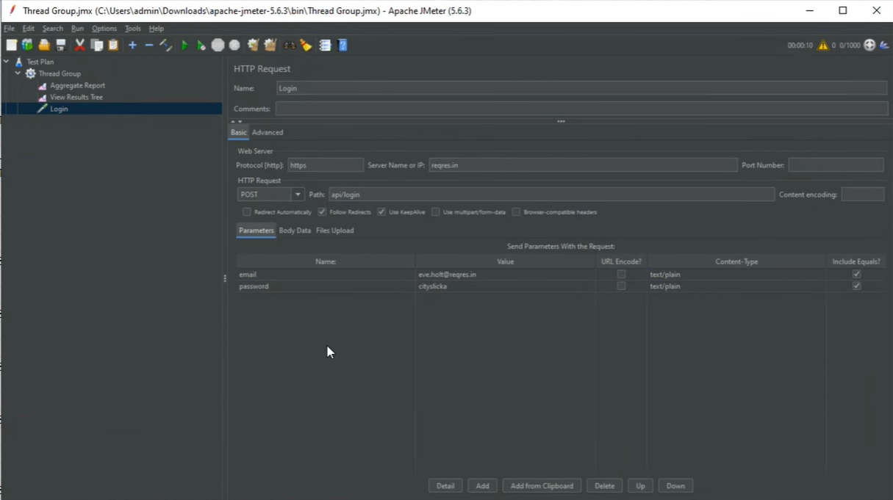
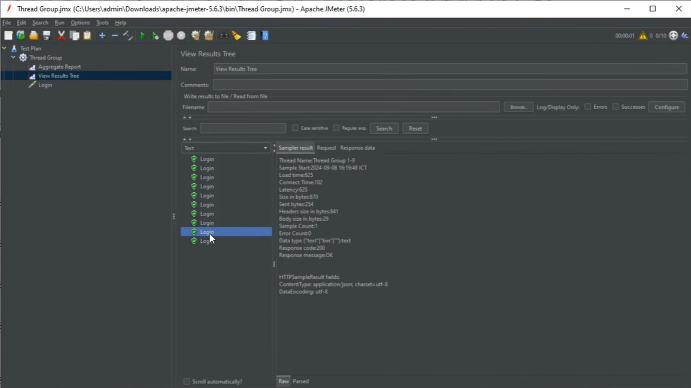

# JMeter Assignment – API Testing

## 1. Giới thiệu

Dự án được thực hiện nhằm tìm hiểu và thực hành kiểm thử API bằng **Apache JMeter**. Thông qua bài thực hành, người thực hiện làm quen với việc cấu hình kịch bản kiểm thử, gửi HTTP request và kiểm tra phản hồi từ máy chủ.

## 2. Mục tiêu

- Làm quen với giao diện và các thành phần cơ bản của Apache JMeter.
- Thực hiện kiểm thử API bằng HTTP Request.
- Cấu hình các thông số kiểm thử và theo dõi kết quả.
- Kiểm tra mã trạng thái HTTP và nội dung phản hồi.
- Ghi nhận kết quả bằng hình ảnh minh chứng.

## 3. Công cụ sử dụng

| Công cụ | Mục đích |
|---|---|
| Apache JMeter | Thực hiện kiểm thử API |
| Reqres API | API phục vụ thực hành |
| GitHub | Lưu trữ README và hình ảnh minh chứng |

## 4. Nội dung kiểm thử

Bài thực hành tập trung vào chức năng đăng nhập thông qua API.

- **Phương thức:** POST
- **Endpoint:** `https://reqres.in/api/login`
- **Loại kiểm thử:** API Testing
- **Nội dung kiểm tra:** Gửi yêu cầu đăng nhập và kiểm tra phản hồi của API.

### Các bước thực hiện

1. Khởi tạo Test Plan trong JMeter.
2. Thêm Thread Group để cấu hình số lượng người dùng và số lần thực hiện.
3. Thêm HTTP Header Manager và HTTP Request phù hợp với API.
4. Cấu hình dữ liệu yêu cầu đăng nhập.
5. Thêm Listener để quan sát kết quả kiểm thử.
6. Chạy thử nghiệm và kiểm tra phản hồi nhận được.

## 5. Hình ảnh minh chứng

### 5.1. Cấu hình và thực hiện kiểm thử

### 5.2. Kết quả kiểm thử

## 6. Kết quả và đánh giá

Thông qua bài thực hành, người thực hiện đã tìm hiểu quy trình cấu hình và chạy kiểm thử API bằng JMeter, đồng thời làm quen với việc theo dõi phản hồi HTTP và quan sát kết quả qua Listener.

Kết quả thực tế cần được đánh giá dựa trên ảnh chụp sau khi chạy kiểm thử, bao gồm mã trạng thái phản hồi, thời gian phản hồi và trạng thái thành công hoặc thất bại của các request.

## 7. Kết luận

Bài thực hành giúp củng cố kiến thức cơ bản về kiểm thử API và sử dụng Apache JMeter. Đây là nền tảng để tiếp tục tìm hiểu kiểm thử tải, kiểm thử hiệu năng và đánh giá khả năng đáp ứng của hệ thống khi có nhiều yêu cầu đồng thời.
